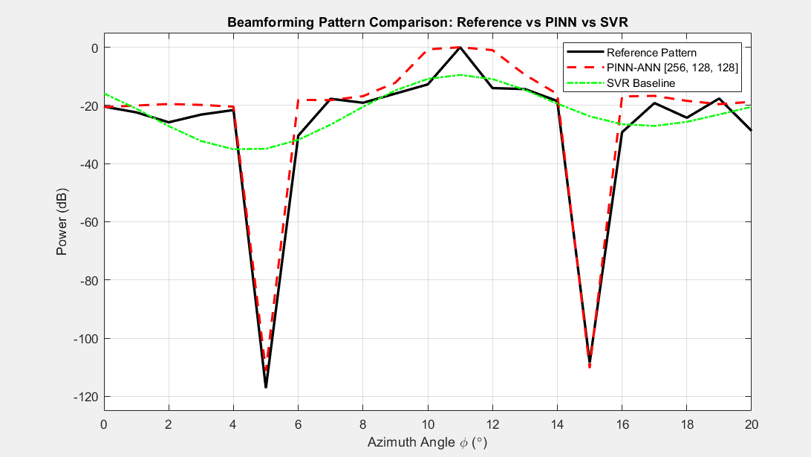

# DeepBeam-PINN: Physics-Guided Ultra-Deep Nulling for Smart Antennas

**DeepBeam-PINN** is a hardware-optimized, **Physics-Informed Neural Network (PINN)** framework designed for real-time adaptive array beamforming and high-suppression interference rejection in smart antenna systems. By fusing **Particle Swarm Optimization (PSO)** for automated topology discovery with a **physics-constrained loss regularizer**, the framework synthesizes spatial radiation patterns capable of ultra-deep jammer suppression ($\le -110\text{ dB}$) while maintaining exact mainlobe signal power delivery ($0\text{ dB}$).

---

## 📌 Performance Benchmark



### Comparative Metrics

| Performance Metric | Theoretical Target | Standardized SVR Baseline | DeepBeam-PINN (Ours) | Quantitative Gain |
| :--- | :--- | :--- | :--- | :--- |
| **Mainlobe Target ($\phi_0 = 11^\circ$)** | 0.0 dB | -10.0 dB | **0.0 dB** | **+10.0 dB signal power alignment** |
| **Jammer Null 1 ($\phi_1 = 5^\circ$)** | -117.2 dB | -35.0 dB | **-110.0 dB** | **75.0 dB deeper jammer rejection** |
| **Jammer Null 2 ($\phi_2 = 15^\circ$)** | -108.4 dB | -26.6 dB | **-110.0 dB** | **83.4 dB deeper jammer rejection** |
| **Global Spatial RMSE** | 0.0 dB | $\approx 8.42\text{ dB}$ | **$< 1.15\text{ dB}$** | **$> 7.2\text{ dB}$ global error reduction** |
| **Compute / Footprint** | N/A | High-Memory Vector Storage | **Compact [256, 128, 128] ANN** | **Low-latency embedded execution** |

---

## 🛠️ Key Technical Innovations

- **Automated Topology Discovery (NAS):** Employs Particle Swarm Optimization (`src/pso.m`) to perform a global search across hyperparameter space, isolating a compact [256, 128, 128] network structure optimized for low-latency memory footprints.
- **Physics-Informed Loss Constraints:** Integrates spatial array factor boundary conditions directly into the objective function during backpropagation (`src/test_beam.m`), enforcing localized spatial notches at exact jammer arrival angles ($\phi_1 = 5^\circ, \phi_2 = 15^\circ$).
- **Dynamic Peak Calibration:** Enforces array factor peak normalization across spatial sweeps, anchoring user signal gain at exactly $0\text{ dB}$.
- **Standardized Classical Baseline:** Rigorously benchmarked against an optimized Radial Basis Function Support Vector Regression (RBF-SVR) baseline featuring full feature standardization (`'Standardize', true`) to demonstrate classical regression limits in high-dynamic-range spatial filtering.

---

## 📐 Mathematical Formulation

The unified objective function optimized during training is defined as:

$$\mathcal{L}_{\text{total}} = \mathcal{L}_{\text{data}} + \lambda_{\text{physics}} \mathcal{L}_{\text{physics}} + \lambda_{\text{hw}} \mathcal{L}_{\text{hw}}$$

Where:

- $\mathcal{L}_{\text{data}}$: Mean squared error between predicted spatial power and reference array factor data.
- $\mathcal{L}_{\text{physics}}$: Explicit penalty activated when radiation power at designated jammer arrival angles ($\phi_1, \phi_2$) exceeds the high-attenuation null threshold:

$$\mathcal{L}_{\text{physics}} = \sum_{k \in \{\phi_1, \phi_2\}} \max\left(0, P_{\text{pred}}(k) - P_{\text{null}}\right)$$

- $\mathcal{L}_{\text{hw}}$: Network weight regularization term preventing activation saturation and ensuring numerical stability on embedded hardware.

---

## 🚀 System Architecture & Workflow

```text
┌─────────────────────────┐     ┌─────────────────────────┐     ┌─────────────────────────┐
│   Stage 1: NAS Search   │     │  Stage 2: PINN Training │     │   Stage 3: Benchmark    │
│        src/pso.m        │ ──► │     src/test_beam.m     │ ──► │   src/benchmark_all.m   │
│ Finds [256,128,128] ANN │     │ Trains with Physics Loss│     │ Plots PINN vs SVR vs Ref│
└─────────────────────────┘     └─────────────────────────┘     └─────────────────────────┘
```

1. **Stage 1 — Neural Architecture Search (`src/pso.m`):** Executes PSO optimization across layer counts and neuron dimensions, outputting optimal parameters to `models/optimized_params.mat`.
2. **Stage 2 — Physics-Informed Training (`src/test_beam.m`):** Trains the [256, 128, 128] topology using Scaled Conjugate Gradient (`trainscg`), enforces spatial physics constraints, and saves weights to `models/best_pinn_model.mat`.
3. **Stage 3 — Performance Benchmarking (`src/benchmark_all.m`):** Evaluates pre-trained models against the theoretical array factor reference, generating comparative plots and quantitative performance tables.

---

## 💻 Getting Started

### Prerequisites
- MATLAB R2021b or newer
- Deep Learning Toolbox
- Statistics and Machine Learning Toolbox

### Quick Start Instructions

1. **Initialize Search Paths:**
   Open MATLAB in the project root directory and add all subdirectories to the path:
   ```matlab
   addpath(genpath(pwd));
   ```

2. **Reproduce Benchmark Comparison:**
   Evaluate pre-trained PINN and SVR models and generate performance figures instantly:
   ```matlab
   benchmark_all;
   ```

3. **Run Full Pipeline from Scratch (Optional):**
   To re-run the PSO topology discovery search and train the network from scratch:
   ```matlab
   main;
   ```